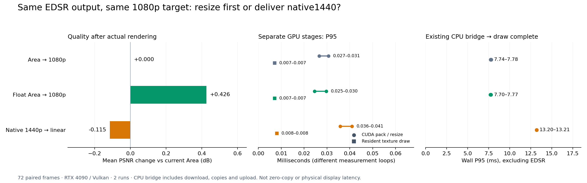
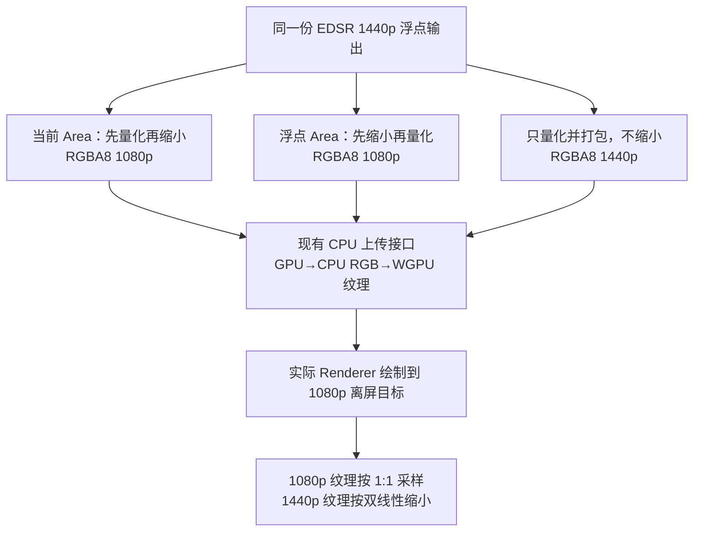
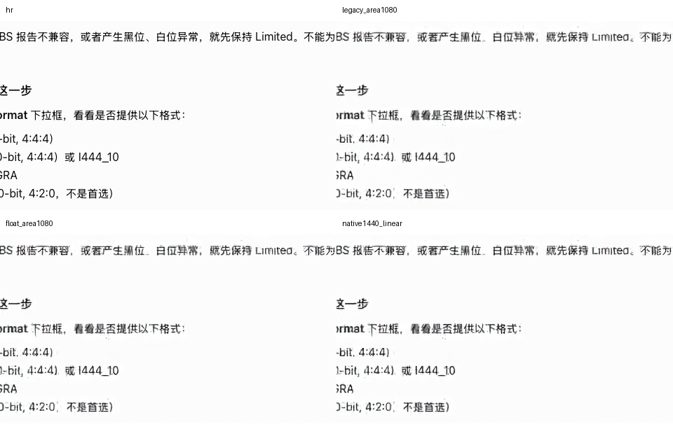

# 先缩到 1080p 与交付 1440p 再渲染：2026-11-04

**后续状态：** 本文记录比较实验当时的实现与数据；之后已将浮点 Area 接入可选 CUDA 运行时，详见 [采用与回归验证](FLOAT-AREA-RUNTIME.zh-CN.md)。此处历史渲染结果保持不变。

本实验对应的问题是：**保持 720p 输入和同一个 EDSR ×2 模型，比较提前缩到 1080p 与保留 1440p 交给渲染器。** 最终渲染目标统一为 1920×1080 个物理像素，不比较 540p 输入，不修改模型为 ×1.5。

**结果：在当前渲染器、1080p 目标和这批 72 帧上，优先保留提前缩小路径。** 直接交付 1440p 的平均 PSNR 为 31.378664 dB，比当前 Area 低 0.114653 dB，比浮点 Area 低 0.540364 dB；相对浮点 Area，72/72 帧 PSNR 都下降。现有 CPU 上传接口的后处理到绘制完成 P95 也由约 7.7–7.8 ms 增至 13.2 ms。这个耗时结论仅适用于本实验明确测量的 CPU 桥接，不能外推到尚未实现的零拷贝接口。



## Reviewer：最终显示出来的画质差多少？

| 路径 | 平均 PSNR，dB | 相对当前 Area 的 ΔPSNR，dB | 平均 SSIM | 最差帧 ΔPSNR，dB | 改善 / 下降帧数 |
| --- | ---: | ---: | ---: | ---: | ---: |
| 当前 Area → 1080p 纹理 → 渲染 | 31.493317 | 0 | 0.954547 | 0 | 0 / 0 |
| 浮点 Area → 1080p 纹理 → 渲染 | **31.919028** | **+0.425711** | **0.955890** | −0.048459 | 64 / 8 |
| 直接 1440p 纹理 → 渲染器双线性缩到 1080p | 31.378664 | −0.114653 | 0.954425 | −0.553738 | 12 / 60 |

改善/下降按 ±1e−6 dB 统计。直接交付 1440p 相对当前 Area 的最佳单帧提升为 +0.126035 dB，并非每帧都更差；相对浮点 Area 则全部下降，单帧差值范围 −1.625185 至 −0.002840 dB。没有按最佳帧选择展示样本。

两个 1080p 路径经过实际渲染后，都与各自缩放输出逐像素一致；72 帧 PSNR/SSIM 也与上一轮相应结果完全一致。1440p 路径实际渲染与独立 CPU 双线性参考的最大单通道差为 2，平均不同通道元素比例为 2.71774%。报告的质量指标来自 **实际 GPU 渲染结果**，没有用 CPU 近似替代。

OCR 一致性代理误差分别为 362/2,986（12.123%）、363/2,986（12.157%）、380/2,986（12.726%）；同样不支持直接交付 1440p 改善文字的结论，但小样本、英语 OCR 和伪参考的限制不允许将它解释为人类阅读实验。

## Reviewer：省掉 resize 后，到底有没有变快？

| 路径 | CUDA 转换/打包 P95，两轮，ms | 已驻留纹理 GPU 绘制 P95，两轮，ms | 经现有 CPU 上传接口到绘制完成 P95，两轮，ms |
| --- | --- | --- | --- |
| 当前 Area1080 | 0.030720 / 0.026624 | 0.007168 / 0.007168 | 7.738578 / 7.778193 |
| 浮点 Area1080 | 0.029696 / 0.024576 | 0.007168 / 0.007168 | 7.701205 / 7.773004 |
| 直接1440p | 0.035840 / 0.040960 | 0.008128 / 0.008128 | 13.204923 / 13.205573 |

本次没有观察到省去 resize 的速度收益：1440p 仍需转换/打包更多像素；绘制成本本身都只有约 7–8 微秒；明显的时间差出现在包含下载、CPU 副本和上传的桥接路径。这里没有进一步拆分并归因各项副本成本，也没有将绘制范围的微小差异宣称为普遍的性能排名。

**这些都不包含 EDSR 推理。** 两条路线共用同一个模型输出，模型计算并未减少。图中范围是两轮 P95 的范围，不是置信区间；也不是每一帧都落在该区间。

## Reviewer：究竟比较了哪些路径？

三种方案读取同一份 EDSR 原生 2560×1440 浮点输出。前两个方案分别保留当前 Area 和上一轮的浮点 Area 候选；第三个方案完全省去 CUDA resize，仅转换并打包原生尺寸。模型的混合精度分配和权重不变。



渲染器使用项目 [gpu.py](../../../src/isharescreen/frontend/desktop/gpu.py) 中实际的 `Renderer.upload_enhanced` 和 `Renderer.draw`，不是 OpenCV 缩放代替绘制。RGB 输入纹理与输出 attachment 均为 `rgba8unorm`，采样器的 min/mag filter 为 linear，无 mipmap 金字塔、无 sRGB 纹理转换、无光标或裁剪。

因此，两条主要路径的差异既包括缩放位置，也包括 **Area 与双线性算法**；不是同一个滤波器单纯换了执行位置。直接交付路径先量化为 RGBA8，也不保留浮点 Area 延后裁剪的优势。

## Reviewer：为什么有 CPU 上传，是否已经实现 GPU 纹理互操作？

现有 `upload_enhanced` 接口接收 CPU RGB8 数组。实验明确经过 CUDA RGBA 下载、转成连续 CPU RGB，再调用渲染器打包 RGBA 并上传。没有实现 CUDA/WGPU 零拷贝，不把这条路径的耗时当成未来互操作后的耗时。

现有接口还要求增强图是 canvas 的两倍尺寸。为复用未经修改的类，1080p 支路用 960×540 canvas 实例，1440p 支路用 1280×720 实例。两者都使用完整 16:9 UV 映射和同一个 1080p 绘制目标；不测试输入坐标、光标或动态分辨率。这是复用真实绘制实现的离屏实验，尚不是完整桌面集成。

每帧 RGBA8 纹理载荷：1080p 为 8,294,400 字节（7.910 MiB），1440p 为 14,745,600 字节（14.063 MiB），增加 **77.78%**。这是单份像素数据大小，不是进程峰值显存；暂存、副本和渲染目标另计。

## Reviewer：画质和正确性怎样测试？

使用上一轮冻结的 24 段 Mac 开发验证视频、每段 3 帧，共 72 帧；输入为保存的 720p / 600 Kbps / yuv420p 解码 RGB。LR/HR 文件逐一校验哈希。每帧只推理一次，三种路径分别实际绘制、读回同一个 1080p 目标，对对应 HR 计算 RGB PSNR 和 SSIM。PSNR 是逐帧计算后等权平均。

GPU 输出打包先与 CPU 参考核对：Area 对应 OpenCV `INTER_AREA`，原生打包对应直接舍入裁剪。绘制后的结果再与独立 CPU 参考核对：提前缩小路径为 1:1，1440p 路径为浮点 `INTER_LINEAR` 后量化。允许硬件纹理插值与 CPU 理想插值有最多 2 个 RGB8 等级差异，并记录实测差异。alpha 检查为 255。

SSIM 与 [上一轮](RESIZE.zh-CN.md) 保持相同定义。OCR 也沿用固定 8 个中心裁剪、Tesseract `eng` / PSM 6、删除空白、以高清图 OCR 作伪参考的方法；其中包含中文，代理误差率不能解释为真实文字 CER 或人的可读性。

## Reviewer：三个耗时数字分别表示什么？

1. **CUDA 转换/缩放打包**：模型输出已驻留 GPU，CUDA Graph replay，50 次预热、每轮 1,000 次 CUDA Event 测量。1440p 路径仍需舍入、裁剪、通道重排和 alpha 打包，不能视为零开销。
2. **纹理已驻留时的 GPU 绘制**：实际 Renderer 的 render pass 前后写 GPU timestamp，50 次预热、每轮 1,000 次。包含清屏及绘制，不包含纹理上传、CPU 提交、读回或窗口呈现；原始 ticks 与设备 timestamp period 一并保存。
3. **现有 CPU 上传接口的整段墙钟耗时**：CUDA 转换打包 → 同步下载 RGBA → CPU 连续 RGB 副本 → `upload_enhanced` → `draw` → 等待 GPU 完成。20 次预热、每轮 200 次。包含上述接口分配与副本，不含 EDSR、解码、网络或最终图像读回。

全部方法运行两轮，第二轮反转顺序。资源与管线先创建、预热；模型推理不在这些计时循环里重复。不同范围在独立循环测量，**不可直接将 P95 相加推导整条流水线延迟**。静态重复帧的离屏绘制不包含窗口系统、VSync、屏幕扫描或滚动时序。

共保存 216 条逐帧画质记录和 13,200 个计时样本：6,000 个 CUDA 转换/打包、6,000 个 GPU 绘制、1,200 个桥接墙钟。全部分位数已从原始样本重新计算核对。GPU 绘制保留 6,000 组起止 ticks，设备 period 为 1 ns，并核对了转换后的毫秒值。

## Reviewer：环境和失败尝试是否保留？

运行于 lab / Alienware 的 RTX 4090，GPU UUID `GPU-f3d8b210-4eb5-a38b-a81d-983611f83a6a`，渲染后端 Vulkan。启动及计时分组前检查其他 compute 进程，避免竞争。使用项目 `.venv` 与独立的 TensorRT 11 可选依赖目录。

版本：驱动 595.99.02，PyTorch 2.6.0+cu124，Triton 3.2.0，TensorRT 11.4.0.106，wgpu 0.32.0，OpenCV 4.11.0。任务结束后复查没有 compute 进程，GPU 使用率为 0%。

最初单帧检查的画质部分通过，但安装的 wgpu 0.32.0 的 queue-work-done 回调出现 ABI 签名不匹配。实验改用同库的原生 `GPUDevice._poll_wait()`（`wgpuDevicePoll(wait=true)`）等待提交完成，没有修改依赖或产品渲染器。失败版本脚本与不完整结果留在独立目录；修正后的单帧检查通过后才启动正式实验。此私有同步接口只用于版本固定的基准。

完整原始实验保存在项目本地
`benchmarks/super_resolution/experiments/render-delivery-20261104-v1/`，远端为
`/home/chen/iShareScreen/research/render-delivery-20261104-v1/`。
执行脚本：[compare_render_delivery.py](../../../benchmarks/super_resolution/edsr_cuda/compare_render_delivery.py)。

## Reviewer：原始证据、裁剪和复现方式在哪里？

[数据索引](evidence/render-delivery/README.md) 和 [结果 JSON](evidence/render-delivery/comparison.json) 保留完整逐帧指标、所有计时样本、GPU ticks、设备与源文件身份，仅省略 OCR 原文。本地完整工件还保留全部 32 张原始裁剪、OCR 原文、运行日志、两个 smoke 目录与执行时源码快照。文件哈希列在 [清单](evidence/render-delivery/MANIFEST.json)。

下图是固定首个视频的同一处文字裁剪，按原生像素排列；它不代表所有帧。



正式实验所用渲染器文件 SHA256：
`758beccbf63dd43937bdb95fe408683b973411ad38b87c74568a3ea9eabe807d`。
引擎与输入清单哈希与 [上一轮实验](RESIZE.zh-CN.md) 相同。以下在 **lab 主机项目目录**运行，须有相应冻结输入和引擎，输出目录必须不存在：

```bash
source dev-environment.sh
export PYTHONPATH="$PWD/.venv/optional/tensorrt11:$PYTHONPATH"
python benchmarks/super_resolution/edsr_cuda/compare_render_delivery.py \
  --validation benchmarks/super_resolution/experiments/validation-baselines-2026-10-29 \
  --engine research/edsr-packed-state-20261104/engine-byte-cache/edsr.engine \
  --renderer-source src/isharescreen/frontend/desktop/gpu.py \
  --expected-gpu-uuid GPU-f3d8b210-4eb5-a38b-a81d-983611f83a6a \
  --output research/render-delivery-repeat
```

可另用新输出目录加 `--smoke` 先检查一帧；smoke 的小样本计时不用于性能结论。若产品渲染器已改变，应使用原始实验中的 `source/gpu.py` 快照，或明确记录新渲染器版本。

## Reviewer：这个结论适用于什么，不适用于什么？

结论适用于当前 RGBA8 + 双线性渲染器、1080p 实际渲染目标和这组开发验证画面。没有证明所有直接 1440p 交付方式都不合适：保留浮点纹理、在着色器内做 Area、真正的 GPU 纹理互操作，以及原生 1440p 显示都属于不同方案。

如果目标本身是 1440p，直接使用模型原生输出仍是合理候选，本次没有评估该显示目标。Mac/Metal、真实窗口呈现、HiDPI、滚动稳定性和独立测试集表现也未由本结果验证。产品运行时保持不变。
