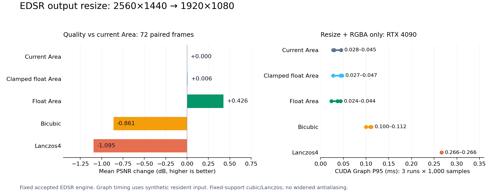
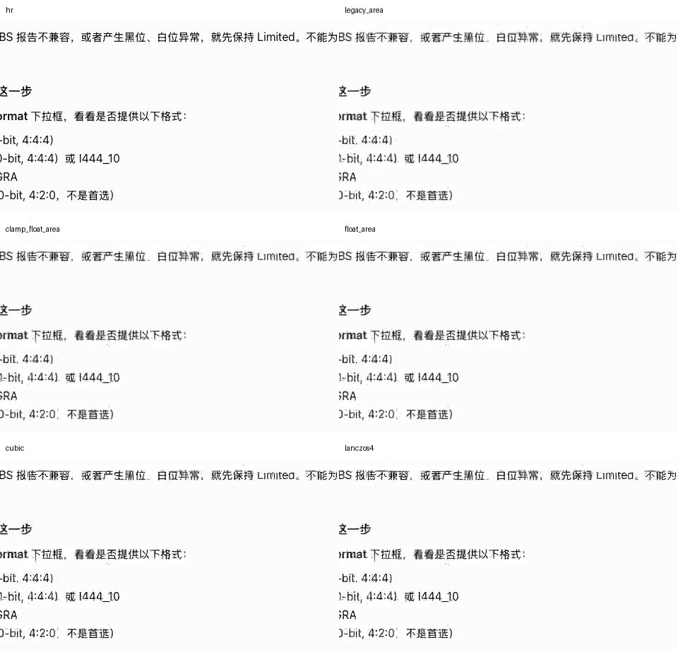

# EDSR 输出缩放实测：2026-11-04

**后续状态：** 本文保留最初筛选实验的结果与当时决策；之后用户批准小幅调整，浮点 Area 已接入可选 CUDA 运行时，新增真实 NVDEC 验证见 [采用记录](FLOAT-AREA-RUNTIME.zh-CN.md)。

**这次最值得继续验证的是浮点 Area：先缩放，最后再裁剪、量化。** 在同一个已接受的 EDSR 引擎、72 帧 Mac 开发验证样本上，相对当前处理平均 PSNR 提升 **0.425711 dB**，SSIM 从 **0.954547 → 0.955890**。但 8 帧 PSNR 下降、OCR 一致性未改善，且没有稳定加速证据，因此它是候选方案，尚未替换运行时。

这次实现的 Bicubic 和 Lanczos4 更慢、平均质量指标也更低。这个结论只针对下文定义的固定支撑滤波器；没有测带尺度自适应抗混叠的版本，不能泛化成“所有 Bicubic/Lanczos 都不好”。

后续已测试 [先缩到1080p与直接交付1440p再渲染](RENDER-DELIVERY.zh-CN.md)：统一绘制到1080p，复用真实渲染器，并分别报告 GPU 绘制和现有 CPU 上传接口的耗时。



## 1. Reviewer：原来的“缩放与量化打包”到底做什么？

输入是 EDSR ×2 的浮点 RGB 输出，尺寸 2560×1440，通道分离；输出为 1920×1080 RGBA8，像素交错，alpha 恒为 255。这里的 RGB8 量化是输出颜色舍入，**不是模型卷积的 INT8 量化**。

当前顺序为：乘 255 → 每个原生分辨率像素先做 nearest-even 整数舍入并裁剪到 [0,255] → Area 缩小到 1080p → 再舍入 → RGBA8 打包。实现见 [pack_area](../../../src/isharescreen/enhancement/cuda_kernels.py)。颜色计算在编码后的 RGB 数值空间进行，本次没有加入线性光变换。

本例缩小比为 3/4，每个输出像素覆盖输入中的 4/3×4/3 区域，各轴最多涉及两个相邻像素。用覆盖面积加权，横轴权重按输出列循环为 3/4、1/2、1/4，纵轴同理，形成四个输入像素的加权和；这是固定比例 Area，不是任意尺寸的通用 resize。

## 2. Reviewer：五个方案怎样区别，能否分清收益来源？

| 名称 / 数据键 | 缩放前 | 缩放方法 | 缩放后 |
| --- | --- | --- | --- |
| 当前 Area / `legacy_area` | 舍入并裁剪 RGB8 | 面积加权 | 舍入，RGBA8 打包 |
| 裁剪后浮点 Area / `clamp_float_area` | 只裁剪，保留小数 | 面积加权 | 舍入并裁剪，RGBA8 打包 |
| 浮点 Area / `float_area` | 保留原浮点值，包括超出范围的值 | 面积加权 | 舍入并裁剪，RGBA8 打包 |
| Bicubic / `cubic` | 保留原浮点值 | 每轴 4 taps，a = −0.75 | 舍入并裁剪，RGBA8 打包 |
| Lanczos4 / `lanczos4` | 保留原浮点值 | 每轴 8 taps，sinc(x)·sinc(x/4) | 舍入并裁剪，RGBA8 打包 |

Cubic/Lanczos 使用半像素中心映射、复制边界、归一化权重；未按缩小比例扩宽滤波核。Area 是单内核；后两者是水平、垂直两次内核，中间保留 FP32 缓冲。因此耗时比较也包含具体实现代价，并非算法的理论最优耗时。

只推迟整数舍入时，平均提升仅 **0.005726 dB**；再推迟裁剪，才达到 **0.425711 dB**。这组受控对照说明，本次主要收益来自裁剪顺序。浮点计算允许超范围值在面积平均中参与抵消，最后才截断；不能把这项收益归因于换成更复杂的插值或改变模型精度。

## 3. Reviewer：是否换了模型、输入或挑选了好看的帧？

没有换模型。每帧只推理一次，五个方法读取同一份模型浮点输出。固定引擎 SHA256 为：

`74f418fb7ad0cd03ae25d6ff701fead1414a6f180e334d13e9281263007dde74`

使用冻结 `validation-baselines-2026-10-29/INPUTS.json` 中全部 24 个 `720p-600k-420` 视频条目，每条 3 帧，共 72 帧；逐个核验 LR/HR 文件哈希。输入是已保存的 RGB 解码帧，**本次未经过实时 NVDEC**。HR 为对应的 1920×1080 RGB 图。每种方法均输出 RGBA8 后取 RGB 计算指标，alpha 单独检查为 255。

没有重新训练，也没有使用 CodeSCAN held-out test。这批数据曾用于部署开发，结果是开发验证，不是独立泛化结论。72 帧来自 24 个视频，不能视为 72 个完全独立场景。

## 4. Reviewer：画质具体提升多少，有没有退步的帧？

PSNR 以每帧 RGB 全图 MSE 计算，再对帧等权平均；ΔPSNR 是同帧相对当前 Area 的差值。SSIM 使用 7×7 均匀窗、样本协方差、RGB 三通道平均、排除 3 像素边界；CPU 小样本与 `skimage.metrics.structural_similarity` 的对应默认设置核对，误差小于 1e−12。

| 方法 | 平均 PSNR，dB | 平均 ΔPSNR，dB | 平均 SSIM | 最差帧 ΔPSNR，dB | 改善 / 下降帧数 |
| --- | ---: | ---: | ---: | ---: | ---: |
| 当前 Area | 31.493317 | 0 | 0.954547 | 0 | 0 / 0 |
| 裁剪后浮点 Area | 31.499043 | +0.005726 | 0.954975 | −0.000057 | 71 / 1 |
| 浮点 Area | **31.919028** | **+0.425711** | **0.955890** | −0.048459 | 64 / 8 |
| Bicubic | 30.631917 | −0.861400 | 0.952748 | −2.715664 | 3 / 69 |
| Lanczos4 | 30.398570 | −1.094747 | 0.951278 | −3.140733 | 0 / 72 |

帧数统计采用 ±1e−6 dB 阈值。浮点 Area 最佳单帧提升 +1.594570 dB，不能用它代替总体提升。平均更好也不代表每一帧或每个文字笔画都更好。

## 5. Reviewer：GPU 内核算对了吗？

对所有 72 帧，分别在 CPU 用 OpenCV 4.11.0 的 `INTER_AREA`、`INTER_CUBIC`、`INTER_LANCZOS4` 和同样的裁剪/量化顺序生成独立参考。三个 Area 版本与各自 CPU 参考都逐像素完全相同；Cubic/Lanczos 最大单通道差为 1 个 RGB8 等级，平均有差异的通道元素比例分别约 0.00260% / 0.01264%，均通过预设容差。

这是 GPU 实现正确性检查，不是五个算法之间的像素等价声明，更不是 INT8 引擎与 FP32 模型等价。原先量化门槛使用原来的后处理协议；更换后处理后，还需要让 FP32/AMP 参考使用同一新协议重新检查，不能把本次 +0.426 dB 当作量化损失被无条件消除。

## 6. Reviewer：耗时怎么测，能否说更快？

使用 lab 主机 `Alienware` 的 RTX 4090，UUID `GPU-f3d8b210-4eb5-a38b-a81d-983611f83a6a`，驱动 595.99.02，PyTorch 2.6.0+cu124，Triton 3.2.0，TensorRT 11.4.0.106。开始及每组计时前检查没有其他 GPU compute 进程；结束再次检查，实验进程已退出。

**只计 GPU 上的缩放与 RGBA8 打包，不含模型推理、解码、传输、OCR 或显示。** 输入、输出、滤波权重、临时缓冲都预先驻留 GPU。

第一组：固定最后一帧的真实模型输出，普通提交，各方法预热 50 次、计时 1,000 次；两轮反向顺序，CUDA Event 计时。短内核受提交间隙等因素影响，出现波动。

补充组：每种方法捕获一次完整操作到 CUDA Graph，各预热 100 次、计时 1,000 次，三轮轮换顺序。用 seed 42 的合成 FP32 输入；这些内核没有随输入值改变执行路径的分支。这组仅补充计时，不用于画质评价。Graph 减少逐内核 Python 提交干扰，但短操作仍有抖动，也不是生产完整图中的独立阶段 trace。

| 方法 | 普通提交 P95：两轮，ms | Graph P95：三轮，ms |
| --- | --- | --- |
| 当前 Area | 0.039683 / 0.062469 | 0.027648 / 0.045061 / 0.029696 |
| 裁剪后浮点 Area | 0.051010 / 0.048874 | 0.044032 / 0.027456 / 0.047242 |
| 浮点 Area | 0.048344 / 0.030098 | 0.044064 / 0.023520 / 0.037018 |
| Bicubic | 0.125952 / 0.103074 | 0.111616 / 0.100000 / 0.109568 |
| Lanczos4 | 0.272704 / 0.273312 | 0.266240 / 0.266240 / 0.266240 |

图中的区间是三轮 P95 的最小值到最大值，**不是置信区间**。保留全部 25,000 个原始计时样本，并重新计算核对分位数。数据支持三个 Area 都很轻量，但没有稳定证据证明浮点 Area 更快。不能把孤立 resize 的 P95 与旧流水线 P95 相减、相加或替换，推导新的 UDP/显示延迟。

## 7. Reviewer：文字真的更容易读了吗？

尚不能下结论。额外抽取视频索引 0、3、6、9、12、15、18、21 的首帧，固定中心 960×540 区域，共 8 个裁剪。使用 Tesseract `eng`、PSM 6，将高清参考图的 OCR 字符串作为伪参考，删除空白后计算编辑距离。没有人工文字标注，而且画面含中文，英语 OCR 本身可能严重错误；该指标只能叫 **OCR 一致性代理误差**，不能叫真实文字 CER。

| 方法 | 编辑距离合计 / 伪参考字符数 | 代理误差率 |
| --- | ---: | ---: |
| 当前 Area | 362 / 2,986 | 12.123% |
| 裁剪后浮点 Area | 343 / 2,986 | 11.487% |
| 浮点 Area | 363 / 2,986 | 12.157% |
| Bicubic | 383 / 2,986 | 12.827% |
| Lanczos4 | 364 / 2,986 | 12.190% |

浮点 Area 的 PSNR 改善没有转化为这个小样本代理指标的改善。裁剪后浮点 Area 的 OCR 更低，也不足以确立可读性优势。需要中文/英文人工转写、固定文字区域和更多样本才能验证。

下图固定展示第一个采样视频的同一处裁剪，按原生像素排列，不是按最佳效果挑图。完整 8 组 × 6 张裁剪保留在本地原始实验目录。



## 8. Reviewer：是否应该立即替换？还缺什么？

当前结论是将浮点 Area 作为下一轮候选，而不是立即替换。它在这批帧上的平均质量收益明显，运行成本与当前 Area 接近；Bicubic/Lanczos4 的本次实现没有胜出。

替换前仍需在真实 NVDEC 输入上配对复测、用统一后处理重验 FP32/AMP 质量门槛，检查中文/英文文字和滚动时的闪烁，再运行完整流水线。独立测试集用于最终评价，不用于反复挑算法。带抗混叠 Bicubic/Lanczos、线性光缩放、联合优化 EDSR 尾部与最终缩放均未在本次实验中验证，不承诺它们一定更好。

## 9. Reviewer：证据和复现入口在哪里？

- [质量、OCR 数量及普通提交原始计时](evidence/resize/comparison.json)：360 条逐帧质量记录、10,000 个计时样本；仅省略 OCR 原文。
- [CUDA Graph 原始计时](evidence/resize/graph-timing.json)：15,000 个计时样本。
- [主实验脚本](../../../benchmarks/super_resolution/edsr_cuda/compare_resize.py) 与 [Graph 补测脚本](../../../benchmarks/super_resolution/edsr_cuda/compare_resize_graph.py)。证据中记录各脚本 SHA256。
- 本地完整原始目录：`benchmarks/super_resolution/experiments/resize-comparison-20261104-v1/`；远端：`/home/chen/iShareScreen/research/resize-comparison-20261104-v1/`。文档 JSON 包装记录原始文件路径、SHA256 和提取规则，可核对来源。

冻结输入清单 SHA256：`f77a4d56927713580cdbe4c6ce0af267e208e47ac8a8b1893382cfd218915a61`。

以下命令在 **lab 主机项目目录**运行，输出目录需不存在。需要对应的冻结输入和引擎工件，仓库不包含这些大文件。第一次尝试使用默认 TensorRT 10，因版本不兼容无法反序列化引擎；该失败目录 `run` 原样保留。正式结果来自显式选用 TensorRT 11 的 `run-trt11`。

```bash
source dev-environment.sh
export PYTHONPATH="$PWD/.venv/optional/tensorrt11:$PYTHONPATH"
python benchmarks/super_resolution/edsr_cuda/compare_resize.py \
  --validation benchmarks/super_resolution/experiments/validation-baselines-2026-10-29 \
  --engine research/edsr-packed-state-20261104/engine-byte-cache/edsr.engine \
  --expected-gpu-uuid GPU-f3d8b210-4eb5-a38b-a81d-983611f83a6a \
  --output research/resize-comparison-repeat
python benchmarks/super_resolution/edsr_cuda/compare_resize_graph.py \
  --expected-gpu-uuid GPU-f3d8b210-4eb5-a38b-a81d-983611f83a6a \
  --output research/resize-comparison-repeat-graph.json
```
