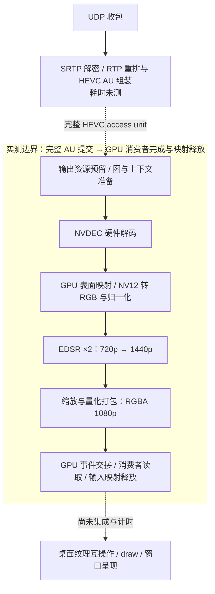

# EDSR 推理优化：reviewer 问答与证据

本文解释 2026-11-04 保留的 EDSR CUDA 引擎。第 1–15 节整理历史实验；第 16–18 节记录后续实际测试与实现更新。历史模型和原缩放流水线数字保持原样，最新输出协议及验证见第 18 节。

## 1. Reviewer：优化的是哪个 EDSR？是否更换了模型或重新训练？

使用 EDSR-baseline ×2，16 个残差块、每层 64 个特征通道，已完成训练的 epoch 25 checkpoint。部署优化期间没有重新训练、剪枝、减少残差块或降低输入分辨率。编译图会被变换，权重会量化，所以“checkpoint 相同”不代表每个计算结果与 FP32 相同。

| 身份 | SHA256 |
| --- | --- |
| 原始 checkpoint | `2c923e9ba9541cb85006684c0072868b2d71354d665cdd85cd2b0baac6faaabb` |
| 保留的 TensorRT engine | `74f418fb7ad0cd03ae25d6ff701fead1414a6f180e334d13e9281263007dde74` |
| 保留的转换后 ONNX | `59e2876981fc5def861a8e085be6f3a2018e7191624051add86f2a28fe62f1d3` |

依据：[运行时身份](SUMMARY.json)、[模型实验汇总](evidence/model/packed-state-summary.json)。不要将此配置推广到 EDSR 的其他深度、宽度或 checkpoint。

## 2. Reviewer：一共有多少层，哪些使用 INT8？

按原始网络中可训练的卷积层计数，共 36 层。以下编号从 1 开始；源码残差块编号从 0 开始。

| 原始网络部分 | 卷积数量 | 保留引擎对应精度 |
| --- | ---: | --- |
| Head，RGB → 64 特征 | 1 | FP16 |
| 残差块 1–15，每块两个卷积 | 30 | INT8 卷积，残差状态另有修正 |
| 残差块 16 | 2 | FP16 |
| Body projection，长跳连之前 | 1 | FP16 |
| ×2 上采样卷积，64 → 256 通道 | 1 | FP16；尾部经过折叠 |
| 最终 RGB 输出卷积，64 → 3 通道 | 1 | FP16；尾部经过折叠 |
| 合计 | **36** | **30 INT8 + 6 FP16** |

输入、输出的两个固定 MeanShift 在原始实现中也是 1×1 Conv2d，但不属于可训练的重建卷积。包括它们时有 38 个 Conv2d 模块。ReLU、PixelShuffle、残差加法不计入上述 36。编译后的节点数还包括常量、重排、边界修正和插件，不能当作原始网络深度。

依据：[模型配置](../../../src/isharescreen/enhancement/models.py)、[30 个卷积的名称清单](evidence/model/balanced-build.json)、[转换源码](../../../research/edsr-source-archive-20261104/source/benchmarks/super_resolution/build_edsr_int8_plugin.py)。

“INT8 卷积”指量化后的权重和激活参与整数卷积；累加、缩放、偏置及残差恢复仍涉及更高精度。不能称这 15 个残差块的所有运算、所有状态都只有 8 位。

## 3. Reviewer：剩余 6 层是真的不能使用 INT8 吗？

现有证据支持“保留方案采用 30/6”，不支持“其余 6 层在任何方法下都不能量化”。我们并没有完成所有层、所有组合的穷举敏感度实验。

最后一个残差块的两层确实测试过 INT8，形成 32 INT8 / 4 FP16 的候选。最快候选模型 P95 为 9.554 ms，保存 RGB 输入检查通过；但实际 NVDEC 输入检查失败：最差帧相对 FP32 损失 0.1172 dB，相对 AMP 损失 0.1187 dB，均超过 0.10 dB 上限。因此拒绝该候选，保留 30/6。不是仅因“平均损失稍大”而主观选择更保守版本。

Head、body projection 和两层 tail 在保留方案中维持 FP16；没有足够的逐层对照证据证明它们绝对不能量化。依据：[32 层 INT8 候选完整结论](evidence/model/rejected-terminal-int8.json)。

## 4. Reviewer：PyTorch、TensorRT、FP16、INT8 是什么关系？

在本项目中，PyTorch 用于定义、训练和直接运行模型；TensorRT 将导出的网络编译成针对 NVIDIA GPU 的推理引擎，选择卷积实现、融合算子并安排内存。二者是执行工具。FP32、FP16、INT8 是数值表示精度，两类概念是独立的。

原始计时使用 PyTorch AMP：模型权重和输入为 FP32，自动混合精度让适合的运算使用 FP16，TF32 关闭。它不是“模型天生就是 FP16”。TensorRT FP16 是另一种执行方案；最后的引擎又进一步混合 INT8/FP16，并使用定制插件。PyTorch 同样可以进行编译优化，TensorRT 也不等于 INT8。

## 5. Reviewer：原来多慢，现在多快？计时是否公平？

以下均为 lab / Alienware 的同一 RTX 4090（UUID `GPU-f3d8b210-4eb5-a38b-a81d-983611f83a6a`），同一 checkpoint、batch 1、1280×720 输入、2560×1440 原生输出。数据已驻留 GPU，经过 warmup，每项计时 1,000 次，用 CUDA Event 记录完成时间。计时期间不附加 profiler；后续 profiling 记录另存。

| 执行方案 | P50，ms | P95，ms | 证据 |
| --- | ---: | ---: | --- |
| PyTorch AMP，优化实验复测 | 64.181 | 64.221 | [baseline-forward](evidence/model/baseline-forward.json) |
| TensorRT FP16，level 5 | 17.120 | 17.263 | [tensorrt-fp16](evidence/model/tensorrt-fp16.json) |
| 最终引擎，普通提交，第一次 | 9.918 | 9.934 | [model-first](evidence/model/model-first.json) |
| 最终引擎，普通提交，重复 | 9.965 | 10.012 | [model-repeat](evidence/model/model-repeat.json) |
| 最终引擎，CUDA Graph，第一次 | 9.864 | 9.882 | [model-first](evidence/model/model-first.json) |
| 最终引擎，CUDA Graph，重复 | 9.915 | 9.933 | [model-repeat](evidence/model/model-repeat.json) |

原始发布基准 P95 是 64.246 ms；表中的 64.221 ms 是后续优化实验复测，不是对原始数字的更正。原始发布结果仍见 [results](../../../results/README.md#latency-protocol)。

最终模型基准包含 GPU 内部输入复制和输出复制；1×1 grid 表示整帧推理，没有靠跳过 tile 或像素提速。此处不含解码、CPU 像素传输、1080p 缩放、网络、显示。各版本使用固定合成输入；它们是同设备、同尺寸的历史实验，不是随机交错的严格配对试验，也不是真实视频逐帧时延分布。不能据此声称跨硬件性能或实际客户端帧率。

## 6. Reviewer：6.4 倍加速中，有多少是我们的方法？

按 P95 计算，64.221 / 10.012 ≈ 6.41 倍，耗时下降约 84.4%。64.221 / 17.263 ≈ 3.72 倍；17.263 / 10.012 ≈ 1.72 倍，后一个区间耗时下降约 42.0%。这些是配置之间的比值。

**17.263 → 约 10 ms 是组合优化结果，不能全部归因于 INT8。** 期间包含尾部卷积代数折叠及边界处理、TensorRT 版本/策略变化、通道平衡量化、定制卷积/残差/量化融合，以及残差状态编码。TensorRT FP16 level 5 是历史阶段基线，不能当作对最终引擎仅改变精度的消融对照。

普通提交与 Graph 的两次 P95 差为约 0.052 和 0.079 ms；说明这两个独立模型实验中的 Graph 收益较小。它不衡量后续整个解码运行时的优化贡献。

字节残差状态这一步的历史模型 P95 从 10.744 降到 9.882 ms，约下降 8.0%，重复为 9.933 ms。它支持这次实现组合的收益，但不能将编译策略和存储变化的贡献完全拆开。依据：[阶段历史](evidence/model/optimization-history.json)、[状态编码实验](evidence/model/packed-state-summary.json)。要单独归因，需要同编译器、同策略、同计时程序下逐项启用/关闭的消融实验。

## 7. Reviewer：量化 scale 怎么来？有没有用测试集调参？

校准选择固定的 72 个 CodeSCAN **训练样本**：每种语言按 ID 排序取前三个，共 24 种语言；选择不依据质量。样本、输入文件和来源清单有哈希校验。这里的 72 个训练样本与后面的 72 帧 Mac 验证图像是两组不同的数据。

最终方案继承的是通道平衡校准，而非仅使用最初的简单 max-absolute 量化：

1. 在训练输入上，收集卷积输入每个通道的绝对值最大值 A_c，以及权重对应输入通道的最大绝对值 W_c。
2. 使用 alpha=0.75，平衡系数 b_c = A_c^alpha / W_c^(1-alpha)，并对零值设置下限。输入除以 b_c，权重乘以 b_c，在量化前保持原卷积的数学关系。
3. 平衡后的激活使用每张量 scale；权重使用每输出通道 scale，零点为 0。模拟量化采用 nearest-even 舍入并裁剪到 [-127,127]；实际插件入口允许有符号 INT8 的 [-128,127]，因此最终仍须验证真实引擎。
4. 通道平衡因子与量化 scale 使用 FP32；模型最终通过插件融合实现，不能从 ONNX 中的 Cast 名称直接判断实际整数计算路径。

依据：[校准选择](evidence/model/calibration-selection.json)、[训练校准摘要](evidence/model/balanced-calibration.json)、[构建配置](evidence/model/balanced-build.json)、[平衡量化源码](../../../research/edsr-source-archive-20261104/source/benchmarks/super_resolution/build_edsr_balanced_int8.py)。

scale 的统计只用训练集；alpha、精度组合等部署选择用 Mac 开发验证集筛选。因此不是“完全未使用验证数据”。没有使用 1,200 个 held-out CodeSCAN test 样本选择量化参数，最终量化引擎也尚未在该完整测试集上重新评估。

## 8. Reviewer：残差修正到底是什么，是否做到了无损？

在前 15 个量化残差块之间的 14 个边界，保留 INT8 主码 q，并用一个字节保存残差的细分修正。对 FP16 状态 s 和缩放因子 f，常规修正码为 round_even((s×f−q)×14)，范围 −7…7，存储码为 0…14；码 15 指示从 FP16 escape 存储读取原值。恢复近似状态为 FP16((q+(code−7)/14)/f)。

实际采用一个字节一个码；物理 4-bit 打包实验更慢，未采用。常规修正是有损表示，不能称与 FP32 等价。escape 还保留稠密 FP16 分配，减少的是读写流量，不是显存容量：该实验 engine context 从 531,578,880 增至 707,788,800 字节，增加约 168.05 MiB；这也不是整个进程的峰值显存。

依据：[编码规则、显存与结果](evidence/model/packed-state-summary.json)、[转换源码](../../../research/edsr-source-archive-20261104/source/benchmarks/super_resolution/build_edsr_packed_state.py)。

## 9. Reviewer：质量通过的定义是什么？0.01 dB 是否意味着完全无影响？

在固定的 24 个 Mac 开发验证视频中各取 3 帧，共 72 帧，输入为 720p / 600 Kbps / yuv420p。模型原生 ×2 输出后按一致的量化和 area resize 流程得到 1080p，与对应 HR 计算 RGB PSNR。对每帧比较优化输出和两个参考模型各自的 PSNR，求差值；不是计算“优化输出对参考输出”的 PSNR。

同时对 FP32 和原始 AMP 两个参考要求：平均 PSNR 损失 ≤0.05 dB，最差帧损失 ≤0.10 dB。以下负数表示质量下降。

| 保留引擎的验证路径 | 对照 | 平均 ΔPSNR，dB | 最差帧 ΔPSNR，dB | 判定 |
| --- | --- | ---: | ---: | --- |
| 保存 RGB 输入 | FP32 | −0.010547 | −0.029861 | 通过 |
| 保存 RGB 输入 | AMP | −0.011838 | −0.079847 | 通过 |
| 实际 NVDEC 输入 | FP32 | −0.012353 | −0.038101 | 通过 |
| 实际 NVDEC 输入 | AMP | −0.013645 | −0.037206 | 通过 |

保存 RGB 路径的最大单通道像素差达到 19（8-bit RGB）；平均 PSNR 损失小不代表所有像素、文字或帧都不变。上述阈值是项目预设的工程门槛，不是人类视觉无损标准；未由此证明 OCR、可读性、时序稳定性或独立测试集等价。依据：[保留引擎质量摘要](evidence/model/packed-state-summary.json)。

## 10. Reviewer：有没有失败结果？能否只报告最快数字？

| 候选 | 模型 P95 | 质量结果与决定 |
| --- | ---: | --- |
| 初期普通 TensorRT INT8/FP16 | 9.963 ms | 平均相对 FP32 −5.189 dB，最差 −9.758 dB；拒绝 |
| 最终保留的 30 层 INT8 配置 | 9.882 / 9.933 ms（Graph） | 保存 RGB 与实际解码检查均通过 |
| 32 层 INT8 fast | 9.554 ms（Graph） | 保存 RGB 通过，实际 NVDEC 最差约 −0.119 dB；拒绝 |

第一行只证明该早期量化方案质量失败，不能证明所有普通 INT8 方法都失败，也没有把全部退化严格归因于残差误差累积。32 层版本说明只检查保存 RGB 输入不足；最终必须验证真正解码出来的输入。依据：[初期失败记录](evidence/model/optimization-history.json)、[末端 INT8 失败记录](evidence/model/rejected-terminal-int8.json)。

## 11. Reviewer：从 UDP 包到 GPU 输出有哪些阶段，各需多久？

下面是概念上的衔接图。UDP 接收路径与这个可选 CUDA 运行时尚未完成桌面集成；虚线连接表示所需的接口衔接，不表示已测得完整链路。

| 阶段或计时范围 | 可报告的数值 | 应如何理解 |
| --- | --- | --- |
| UDP 收包至完整 AU | 未测 | 包重排、丢包恢复与等齐帧可能产生等待 |
| inline 准备 | P95 0.102 ms | 最新两个运行的 preparation_wall；已包含在总量内 |
| 解码提交 API | P95 0.669 / 0.687 ms | 最新 decode_submit_api_wall；包含解析、映射与回调启动等工作，不是独立的硬件解码耗时 |
| NVDEC 硬件执行 | 历史 trace 平均 0.208 ms，P95 0.224 ms | 25 帧旧路径 profiling，仅提供硬件耗时量级，不是最新运行的阶段分解 |
| GPU 映射、颜色转换和归一化 | 最新路径未分别计时 | 归一化融合与旧路径不同，不用旧 kernel 时间替代 |
| EDSR 模型 | 独立基准 P95 9.882 / 9.933 ms | 包含模型基准的 D2D 输入/输出复制；不是最新流水线中隔离出的同一段 |
| 输出缩放、RGBA 打包、交接与释放 | 最新完整路径未分别计时；后续独立缩放实验见第 16 节 | 孤立缩放计时不包括交接/释放，也不是此流水线的阶段 trace |
| 完整 AU 提交至消费者完成/映射释放 | **P50 10.248 / 10.253 ms；P95 10.352 / 10.370 ms** | 两次各 1,000 帧，受控 30 fps 到达，预热后测量 |
| GPU 输出接入桌面到实际屏幕显示 | 未测 | 运行时输出是 GPU RGBA 缓冲区；现有桌面渲染器还需互操作集成 |

依据：[最新第一次](evidence/latency-first.json)、[最新重复](evidence/latency-repeat.json)、[历史硬件 trace 摘要](evidence/model/legacy-nvdec-stages.json)。准备、API、GPU 执行存在包含关系和异步重叠，不可把这些行直接相加。

**不同运行的 P95 相减不是剩余阶段的 P95。** 不把 10.35−9.9 ms 标成“其余部分耗时”，也不据此制作 95.5%/4.5% 的实测堆叠占比图。准确的阶段占比需要对同一批帧采集边界时间戳，并区分 CPU 与 GPU 时间轴。

## 12. Reviewer：10.35 ms 是否等于 UDP 到屏幕延迟，是否稳定低于 10 ms？

都不能这样解释。计时从完整 HEVC access unit 提交开始，排除了 UDP、解复用、编码、真实显示和扫描输出。结束包括消费者事件完成以及输入映射释放，比单纯“生成 RGBA”多了一些资源交接工作。

最新两次 P95 均超过 10 ms。独立模型在 Graph 下 P95 低于 10 ms，但普通提交的重复 P95 为 10.012 ms；P95 本身也不是每帧上限。30 fps 是受控输入节奏，不是模型最大吞吐量。1,000 帧重复使用首个冻结视频，不是 1,000 个独立场景。无法推断 Mac、H100 或实际远程桌面端到端性能。

## 13. Reviewer：72 帧“bit-exact”是否证明 INT8 等价于 FP32？

不证明。清理后的运行时验证比较的是：同一个已接受的混合精度引擎，分别经过运行时路径与独立参考预处理/缩放路径，最终像素是否完全相同。它验证运行时重构和输入/输出转换，没有把量化引擎变回 FP32。

数值质量检查是第 9 节的 PSNR 比较；运行时正确性是 [quality.json](evidence/quality.json) 的 72 帧及所有权检查，两者回答不同问题。

## 14. Reviewer：有无正确性和复现方面尚未解决的问题？

持有输出、延迟消费者、映射重用、缓存淘汰、错误 CUDA context、取消和部分启动失败已有针对性检查。历史清理记录为 CPU 测试 672 passed / 57 skipped；GPU 像素和生命周期检查另行运行。这些是当时的结果，不是本次文档编辑重新跑出的结果。

整个 TensorRT engine 的默认 sanitizer CUDA API 诊断仍未解决，不能称 whole-engine sanitizer-clean。独立内核检查通过不能消除这个限制。

仓库提供运行时构建、验证和计时命令，但需要自行提供对应哈希的 engine 和冻结验证素材；TensorRT plans、训练权重、数据及完整 trace 未随仓库分发。历史构建脚本已归档，恢复到独立 checkout 后仍依赖原始工件与对应环境，尚无从公开下载到重建最终 engine 的完整一键复现流程。见 [操作入口](../../../benchmarks/super_resolution/edsr_cuda/README.md)。

## 15. Reviewer：读者拿到项目后，能独立核验到哪一层？

新增 [模型证据摘要目录](evidence/model/README.md) 将关键历史 JSON 的字段提取纳入文档目录，保留每份原始文件的路径与 SHA256。摘要涵盖所有性能表的 P50/P95、计时条件、质量阈值、通过/拒绝原因和模型身份。原始状态字符串保留为历史记录，不能当作当前项目状态。

已有完整流水线的原始逐帧计时仍在本目录 evidence 中；新增模型摘要不含原始 samples_ms、逐帧质量记录、校准 maxima 和大体积 trace。因此克隆项目可以核对公开结论与摘要的一致性，但重算历史模型分位数或重跑量化校准需要哈希对应的本地原始工件。

独立 CodeSCAN 测试结果仍是 FP32 模型质量与另测 AMP 时延，不把它的 36.213 dB 与此 INT8 引擎的约 10 ms 拼成一个已验证的质量/速度点。完整测试集混合精度质量、真实 UDP 链路、显示互操作与逐帧阶段计时是明确的后续验证项。

## 16. Reviewer：RGBA 1080p 缩放用什么算法，有没有实测更好的方案？

本节记录最初比较时的状态；后续采用见第 18 节。

当前使用固定 3/4 比例的面积加权缩放，在 1440p 先舍入并裁剪 RGB8，再缩小、舍入并打包 RGBA1080p。后续在同一个引擎输出上对比五种后处理：保留浮点值、最后裁剪量化的 Area 平均 PSNR 提升 0.425711 dB，64/72 帧改善、8 帧下降；Graph 独立缩放 P95 为 0.024–0.044 ms，当前 Area 为 0.028–0.045 ms，未证明稳定加速。英文 OCR 一致性代理也未改善。

本次固定支撑的 Bicubic/Lanczos4 更慢且平均质量指标下降；未测试尺度自适应抗混叠版本。尚未替换运行时。算法定义、裁剪/舍入消融、逐帧结果、计时方法、文字裁剪、失败尝试和复现命令见 [缩放算法实测](RESIZE.zh-CN.md)。这项后处理实验没有改变模型的 INT8/FP16 精度分配，也没有更新原有完整流水线延迟。

## 17. Reviewer：能否直接交付1440p，让渲染器缩到1080p？

可以，但当前渲染器使用 RGBA8 双线性采样，效果与提前 Area 缩小不同。同一引擎、72帧、实际 Renderer 离屏绘制到1080p后，直接1440p平均 PSNR为31.378664 dB，当前 Area1080为31.493317 dB，浮点 Area1080为31.919028 dB。直接1440p相对浮点 Area在72帧上均下降。

GPU绘制本身约0.007–0.008 ms；通过现有CPU下载/上传接口，从模型输出后处理到绘制完成的 P95为约13.2 ms（1440p）和7.7–7.8 ms（1080p）。这些数字排除模型推理，也不能代表尚未实现的CUDA/WGPU零拷贝。详见 [实际渲染路径实验](RENDER-DELIVERY.zh-CN.md) 的计时边界、数据和源码快照。该结果针对1080p显示目标，不否定原生1440p显示时保留原尺寸的用途。

## 18. Reviewer：现在是否已采用浮点 Area，实际解码质量有没有重新验证？

已在可选 CUDA 运行时采用。对实际 NVDEC 输入的 72 帧，新缩放相对同引擎旧输出平均 +0.425136 dB；64 帧改善、8 帧下降，最差 −0.059566 dB。与同输入、同浮点 Area 后处理的 FP32 / AMP 参考比较，平均损失分别为 0.005924 / 0.004186 dB，最差帧损失为 0.025861 / 0.023498 dB，均通过原质量门槛。72 帧独立像素参考与资源生命周期检查也通过。

这次只改变末端缩放和裁剪/量化顺序，未改模型或引擎。新旧流水线计时分别存档，不把早期清理记录当作新版本的复测结果。具体实现、完整数据和复现命令见 [浮点 Area 采用记录](FLOAT-AREA-RUNTIME.zh-CN.md)。
